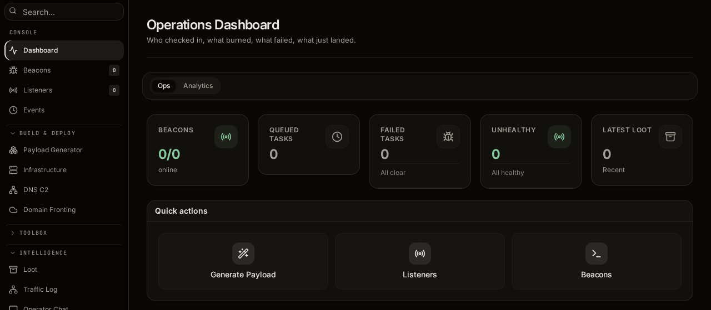
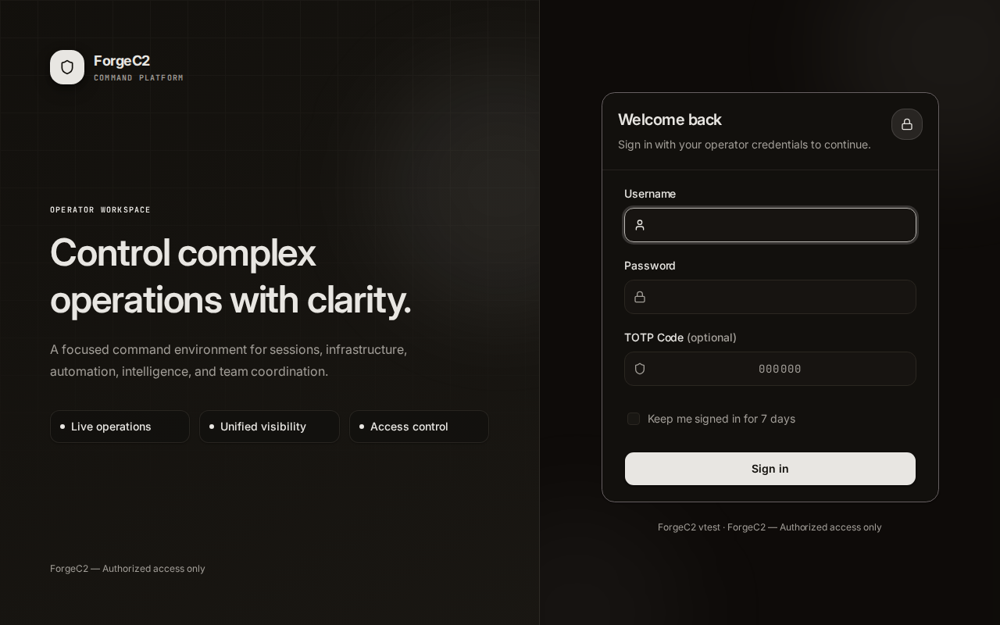

# ⚒️ ForgeC2

**Self-hosted command and control that ships as a single binary.** <!--fact:tasks-->222<!--/fact--> implant tasks, 9 transports, an in-browser payload factory and an AI copilot — with signed releases and hot updates that roll back on failure.

[](https://github.com/r0si/forgec2/actions/workflows/ci.yml)
[](https://github.com/r0si/forgec2/releases)
[](https://github.com/r0si/forgec2/releases)
[](https://github.com/r0si/forgec2/stargazers)
[](https://github.com/r0si/forgec2/graphs/contributors)
[](https://github.com/r0si/forgec2/commits/main)
[](LICENSE)
[](go.mod)

**English** · [中文](README.zh.md) · [Quick start](#quick-start) · [Screenshots](#screenshots) · [Documentation](#documentation)

> ⚠️ **Authorized security testing only.** You must hold explicit written permission from the system owner before using ForgeC2 against anything. See [Legal](#legal).



---

## Quick start

### Option A — one-click archive (no toolchain)

| Platform | Steps |
|---|---|
| **Windows** | Unzip `forgec2-v2.7.1-windows-amd64.zip`, then run `start.cmd` from inside the folder |
| **Linux** | `tar xzf forgec2-v2.7.1-linux-amd64.tar.gz && cd forgec2-v2.7.1-linux-amd64 && ./start.sh` |

Both archives do the same thing on first start:

1. create `config.yaml` from `config.example.yaml`,
2. print the generated `admin` password to the console,
3. serve the console at **<https://127.0.0.1:8000/>** with a self-signed certificate.

Accept the browser warning once, sign in as `admin`, and change the password immediately.

### Option B — Docker

```bash
cp config.example.yaml config.yaml     # required: compose bind-mounts this exact file
docker compose up -d --build
```

The same `https://127.0.0.1:8000/` console comes up with data persisted in the
`forgec2_data` volume.

### Option C — build from source

Go <!--fact:go-->1.26<!--/fact-->+ and Node.js >= <!--fact:node-->24.15.0<!--/fact-->:

```bash
git clone https://github.com/r0si/forgec2.git && cd forgec2

# Windows
powershell -File scripts/deploy.ps1 -NoStart

# Linux / macOS (falls back to npm + go build when pwsh is unavailable)
bash scripts/deploy.sh --no-start
```

`deploy.*` builds the frontend, syncs it into `internal/webdist/dist`, runs the
frontend gates and produces `forgec2-server`. Drop `-NoStart` / `--no-start` to
also restart a running instance with `/health` probing and rollback.

> **Exposed to another host?** The console binds `0.0.0.0` by default. Add that
> hostname to `server.allowed_origins`, or every API call is refused as
> cross-origin. See [docs/DEPLOY.md](docs/DEPLOY.md).

---

## What's inside

| | |
|---|---|
| 🚀 **One binary, everything inside** | React console, REST API, beacon endpoints and SQLite served from one process on one port. No frontend server, no external database engine, no runtime to babysit. |
| 🧬 **Payload factory** | EXE / DLL / PowerShell / ELF / macOS implants, XOR stagers, shellcode, Donut and one-liners, cross-compiled server-side. Custom icons and JPG double-extension disguise built in. |
| 📡 **Nine transports + P2P / external C2** | HTTP(S), WSS, gRPC, mTLS, H2C, TCP, DNS, ICMP and SSH — plus SMB/TCP P2P chaining, Discord/Slack external C2, and experimental QUIC/UDP. |
| 🤖 **AI copilot** | DeepSeek, OpenAI, Claude or any OpenAI-compatible model. Drive the engagement from chat with tool calling and a budget-aware context. |
| 🛡️ **OPSEC as a feature** | Pre-flight rule engine, malleable traffic profiles, AMSI/ETW evasion and sleep masks, with guard rails wired through the payload pipeline. |
| 🧩 **Extensible** | <!--fact:plugins-->52<!--/fact--> drop-in plugins, a JavaScript scripting engine, workflow automation and a complete OpenAPI surface. |

## Implant capabilities

<!--fact:tasks-->222<!--/fact--> task specs, defined once in a shared registry and consumed by both the teamserver and the agent:

- **Access** — shell, PowerShell, execute-assembly, BOF, PowerPick, PE/CLR loading, token steal/make/revert, credentials, mimikatz, kerberoast, DCSync
- **Lateral** — WMI, WinRM, PsExec, pass-the-hash, pass-the-ticket, SMB/TCP relay, SOCKS5, port forwarding, NTLM relay
- **Persistence** — registry, scheduled tasks, startup, WMI, services, COM hijack, IFEO
- **Evasion** — AMSI/ETW bypass, VEH unhooking, hardware breakpoints, sleep masks, sandbox detection
- **Surveillance** — screenshots, live screen, window-titled keylogging, recording, clipboard, remote input
- **Recon** — cookie export, VPN/WiFi credentials, port scanning, process tree, OS/domain discovery

Full per-task, per-OS matrix (including C-implant deltas): [docs/CAPABILITY_MATRIX.md](docs/CAPABILITY_MATRIX.md)

## Screenshots



The console ships <!--fact:routes-->43<!--/fact--> routed pages: a live operations
dashboard, the payload generator, agent detail (files, terminal, persistence,
screen, tokens), a token lab, malleable profiles, campaigns, phishing, BloodHound
ingestion and fifteen settings sections — in dark and light themes.

## Transports

| Transport | Status | Notes |
|---|---|---|
| HTTP(S) | Core | The default path for every platform |
| TCP | Core | Raw socket listener |
| DNS | Hardened | DoH/DoT fields, fragmented queries |
| WSS | Hardened | Persistent WebSocket, binary frames, ping |
| gRPC | Hardened | `grpcs://` TLS + keepalive; mTLS with a client CA |
| SSH | Experimental | Credentials and host-key pinning |
| ICMP | Hardened | Envelopes split across Echo payloads |
| UDP | Experimental | One datagram per beacon |
| QUIC | Experimental | TLS 1.3, ALPN `h3`/`fc2`, stream-framed |
| mTLS / H2C | Experimental | Selector only on the generate form |
| SMB P2P | Hardened | Windows named pipe / Unix socket |

Status values match [docs/CAPABILITY_MATRIX.md](docs/CAPABILITY_MATRIX.md), which
is the source of truth and is regenerated from the task registry.

## Supply chain & updates

C2 infrastructure is a high-value target, so the release path is built to be checked rather than trusted:

- **Signed releases.** Every binary and archive ships with a `.sha256` and a detached Ed25519 `.sig`. Tag builds **fail closed** when the signing key is missing.
- **SBOM** attached to the release, next to the per-artifact checksums.
- **Verifiable hot updates.** The server downloads the matching asset, verifies checksum and signature, snapshots the database, restarts through a generated restarter, and records the outcome in `.update/last`. A boot that fails to come back healthy rolls back to the previous binary. Concurrent updates are refused with `409` and a lock file.
- **12 CI jobs** cover formatting and vet, golangci-lint (with gosec), govulncheck, gitleaks, the race detector, fuzzing, the C-implant build, Docker, API smoke, agent E2E, the frontend gates and live E2E.
- **410 Go test files and 182 frontend test files**, plus OpenAPI contract checks, i18n key coverage and a byte-identical embedded-bundle check.

## How it compares

| | **ForgeC2** | Sliver | Mythic | Havoc | Cobalt Strike |
|---|---|---|---|---|---|
| **Packaging** | One binary, embedded web UI | Server + CLI client | Docker Compose stack | Teamserver + Qt client | Java teamserver + desktop client |
| **Web console** | ✅ built in | ❌ | ✅ | ❌ (Qt desktop) | ❌ (desktop) |
| **Transports** | 9 built in + QUIC/UDP/SMB P2P | mTLS, WireGuard, HTTP(S), DNS | via installable C2 profiles | HTTP(S), SMB, External C2 | HTTP(S), DNS, SMB, TCP |
| **Payload builds** | Server-side cross-compile | Server-side Go compile | Per-agent containers | Teamserver | Artifact Kit add-on |
| **AI copilot** | ✅ | ❌ | ❌ | ❌ | ❌ |
| **Update path** | Signed, in-app, rolls back | Manual replace | `mythic-cli` check only | Manual | Vendor updater |
| **License** | MIT | GPL-3.0 | BSD-3-Clause | GPL-3.0 | Commercial |

*Structural comparison as of October 2026, taken from each project's public
documentation. It compares packaging and delivery, not tradecraft or detection
rates.*

## Architecture

```
                    ┌───────────────────────────────────────────────────────────────┐
   Operators ──────▶│ ForgeC2 — one binary, one port :8000                          │
                    │                                                               │
                    │    ┌──────────────┐  ┌──────────────┐  ┌───────────────────┐  │
                    │    │    Web UI    │  │   REST API   │  │      Beacon       │  │
                    │    │  React+Vite  │  │   Gin + WS   │  │     endpoints     │  │
                    │    │  (embedded)  │  │     + AI     │  │                   │  │
                    │    └──────────────┘  └──────────────┘  └───────────────────┘  │
                    │                                                               │
                    │ SQLite · plugins · scripting · OPSEC rules                    │
                    │ build queue ──▶ cross-compiled implants                       │
                    └───────────────────────────────┬───────────────────────────────┘
                                                    │
             HTTP(S) · WSS · gRPC · mTLS · H2C · TCP · DNS · ICMP · SSH
                                                    │
                    ┌───────────────────────────────▼───────────────────────────────┐
                    │ Windows / Linux / macOS implants (+ P2P)                      │
                    └───────────────────────────────────────────────────────────────┘
```

Deep dive: [ARCHITECTURE.md](ARCHITECTURE.md)

## Configuration

Everything lives in one YAML file — [config.example.yaml](config.example.yaml) is the reference:

| Key | Purpose |
|---|---|
| `server.port` / `server.tls_enabled` | Listen address and TLS termination (on by default, self-signed cert generated on first boot) |
| `server.allowed_origins` / `cookie_domain` | Cross-host and cross-domain deployment |
| `implant.default_interval` / `default_jitter` | Beacon cadence defaults |
| `ai.provider` / `api_key` / `model` | AI assistant backend |
| `rate_limit.login.*` | Auth brute-force protection |

Secrets (JWT, beacon key, loot/ext-c2/backup/TOTP/CSRF keys) are generated on
first boot and stored in the same file with `0600` permissions.

## Documentation

- [docs/DEPLOY.md](docs/DEPLOY.md) — deployment, TLS, reverse proxies, upgrades
- [docs/CAPABILITY_MATRIX.md](docs/CAPABILITY_MATRIX.md) — per-task, per-OS capability matrix
- [docs/COMMAND_REFERENCE.md](docs/COMMAND_REFERENCE.md) — task and command reference
- [ARCHITECTURE.md](ARCHITECTURE.md) — request paths, storage, build pipeline
- [docs/PLUGIN_AUTHORING.md](docs/PLUGIN_AUTHORING.md) — plugin manifest, tiers and signing
- [CONTRIBUTING.md](CONTRIBUTING.md) — build, test and release conventions
- [SECURITY.md](SECURITY.md) — vulnerability disclosure
- [CHANGELOG.md](CHANGELOG.md) — release history

## Legal

ForgeC2 is for **authorized security testing only**. You must have explicit
written permission from the owner before using it against any system. See
[LICENSE](LICENSE).

---

*Forge your access. Control your narrative.*
